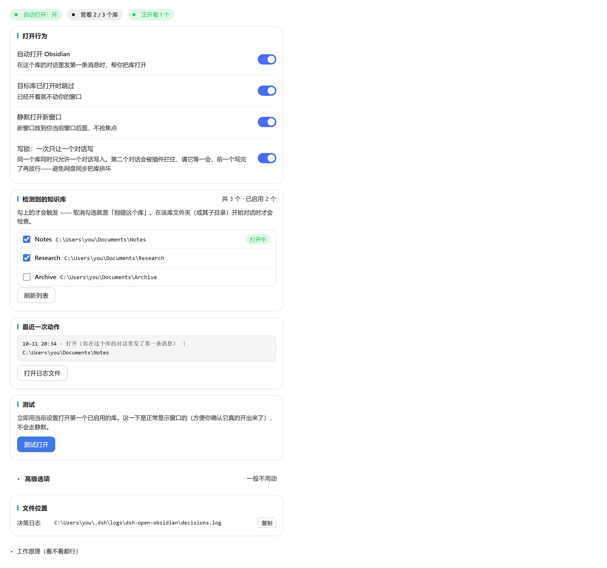
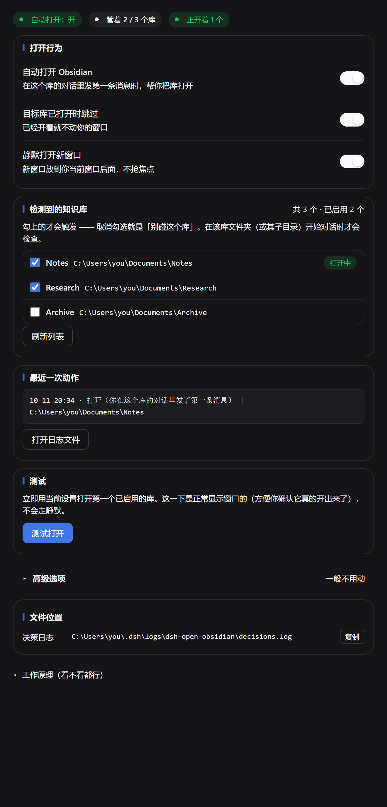

# dsh-open-obsidian

**这是一个给 [DeepSeek Harness](https://github.com/deepseek-ai/deepseek-harness)（简称 DSH）用的插件，不是 Obsidian 插件。**
装进 Obsidian 里没有任何作用，Obsidian 也不会加载它。

English speakers: [jump to the English version](#english).

---

## 它做什么

当一个 DSH 会话的工作目录位于某个 Obsidian 库文件夹内时，你在那个会话里**发出第一条消息**
的那一刻，插件会帮你在 Obsidian 里打开这个库——**这样你装的同步插件（例如坚果云同步、
Obsidian Sync、Git 插件）就会开始工作，AI 在库里改的东西才能真正同步出去。**

这是它解决的实际问题：AI 在库里写了东西，可 Obsidian 没开着，同步就不会跑——等到
你哪天自己打开 Obsidian，改动才姗姗来迟。现在库会在对话开始时就打开，同步从那一刻起就在走。

它尽可能不打扰你：

- 库**已经开着** → 什么都不做（不新开窗口，也不抢焦点）；
- Obsidian **已经在运行** → 新窗口压到后面，焦点立刻还给你；
- Obsidian **没在运行** → 正常启动（这时候窗口弹出来正是你要的）。

全程在 DSH 进程内完成、不经过模型：**零 token、零轮询。**

这个插件的设置面板是**中文界面**（本来就是给中文用户做的），所以这份说明也以中文为主。

> **关于作者**：本插件的作者没有编程背景，代码是在 DSH 的 AI 助手协助下完成的。

---

## 运行要求

| | |
|---|---|
| 系统 | **仅支持 Windows。** 它依赖 Windows 的进程/窗口接口、`%APPDATA%\obsidian` 注册表，以及 Obsidian 注册的 URL 协议；在 macOS / Linux 上无法工作。 |
| DSH | 需要暴露了本插件所用内部接口的 DSH 版本（见下面「已知限制」）。 |
| Obsidian | 桌面版 1.x。开发与实测用的是 **1.14.4**。 |

---

## 安装

一条命令装好：

```sh
dsh plugin --profile desktop add github:NOOBnoob163/dsh-open-obsidian
```

> `dsh` 命令不在 PATH 里时，先在应用标题栏的 **应用** 菜单点 **管理 dsh 命令…** → **安装**。

本包声明了 `dsh.bundle`，所以 DSH 装完会**自动启用**它，不需要手工改任何配置。
**装好后冷启动一次 DSH**（刷新页面不够），然后到 **设置 → Obsidian 助手** 里勾选你要管的库。

<details>
<summary>也可以手工装（不进 bundle 机制）</summary>

把仓库放进 profile 的插件目录：

```sh
# 如果你用的不是默认的 "desktop" profile，把 <profile> 换成你自己的
git clone https://github.com/NOOBnoob163/dsh-open-obsidian.git \
  "%USERPROFILE%\.dsh\profiles\<profile>\plugins\dsh-open-obsidian"
```

然后**二选一**：

- **走标准方式**：把 `dsh-open-obsidian` 加进 profile `package.json` 的
  `dsh.profile.bundles` 列表，由它自带的 `cordis.patch.yml` 负责挂载；**或者**
- **手工挂载**：在 `%USERPROFILE%\.dsh\profiles\<profile>\cordis.patch.yml` 里加一段：

  ```yaml
    # Obsidian 助手（本地插件 plugins/dsh-open-obsidian）
    - insert:
        - id: obsidian-launch
          name: 'dsh-open-obsidian'
  ```

  （`config` 段可以省略——实际设置存在
  `%USERPROFILE%\.dsh\storages\dsh-open-obsidian.json`，面板上改的就是它。）

</details>

### 配置

打开 **设置 → Obsidian 助手**，勾选你想让它管的库。
**一个都不勾 = 完全不触发。**

### 长这样




---

## 设置项

所有开关**改一下就立即保存**，没有"保存"按钮。

| 设置项 | 默认 | 作用 |
|---|---|---|
| **自动打开 Obsidian** | 开 | 总开关。关掉 = 插件永远不打开任何东西。 |
| **检测到的知识库**（逐个库） | 全不勾 | 勾选要管的库。每个库的「已打开」状态都会拿**正在运行的** Obsidian 核实，所以关着的库不会被显示成开着。 |
| **目标库已打开时跳过** | 开 | 已经在屏幕上的库，完全不碰。 |
| **静默打开新窗口** | 开 | 新开的窗口压到后面，而不是让它抢走焦点。 |
| **高级选项** | — | 可选的自定义启动命令。`{vault}` 会替换成解析出的库文件夹路径。留空 = 用 Obsidian 自己的 `obsidian://` 协议。 |

每一次"打开"和"跳过"都会记进 `%USERPROFILE%\.dsh\logs\dsh-open-obsidian\decisions.log`
（有大小上限），所以插件但凡动过手，事后都能查是哪次触发的。面板上有按钮直接打开它。

---

## 触发时机

插件只在**两种时机**打开 Obsidian，且都带去重和节流：

1. **会话的第一条真人消息**（工作目录在已启用的库内）。每个会话只判定一次。
2. **写入时兜底** —— 已启用的库里有文件变动，**但必须**满足"代理（AI）最近确实在这个库里干活"
   且"Obsidian 没在运行"。

DSH 的生命周期事件**故意不作为**触发条件。0.7.0 之前的版本会在 `session/created` 时也尝试打开，
而这个事件在**每次会话发布**时都会触发（界面加载、断线重连、宿主启动恢复上次工作区），
结果就是你什么都没干、Obsidian 自己弹出来了。0.7.0 已移除。无关的文件变动
（同步客户端、编辑器、`git` 维护）同样不会触发。

---

## 已知限制

**1.「打开一个没开的库、同时完全不打扰你」做不到。**
Obsidian 自己没有实现这个能力：它新建窗口用的是会抢焦点的 `show()`，而不是不抢焦点的
`showInactive()`，并且全程序没有任何跟焦点相关的开关（这是读它自己的 `app.asar` 确认的，
`showInactive` 出现 0 次）。

插件的做法是"新窗口压到后面 + 把焦点抢回来"。所以当被打开的库原本没开着时，**大约三次里
有两次会闪一下，约 0.1 秒**。没有第三条路——外部程序拦不住 Obsidian 自己激活窗口，只能事后纠正。

**接受不了可以关掉「静默打开」，就变回"正常打开、会跳到前台"。**

**2. 插件用了 DSH 的内部接口**（Web 路由注册、会话事件、设置页插槽、`__ModuleLoader__`）。
DSH 迭代很快，它一升级，插件有可能失效，需要跟着更新。欢迎提 issue。

---

## 目录说明

```
package.json                        插件清单（简介保持一句话，版本历史在 CHANGELOG.md）
lib/index.js                        宿主半 —— 库识别、触发判定、启动
lib/client.js                       浏览器半 —— 设置页的「Obsidian 助手」面板
bin/dsh-open-obsidian-silent.exe    编译好的助手程序：枚举窗口 + 静默打开
src/silent-open-helper.cs           上面那个 exe 的 C# 源码
test/behaviour.mjs                  行为回归测试（12 项）
test/panel.mjs                      设置面板测试（28 项）
```

**`bin\*.exe` 是故意一起提交的**——多数人没有 C# 编译器，而"静默打开"和"枚举 Obsidian 窗口"
都离不开它。源码一并在库里，方便审计和自行重新编译。

重新编译那个助手程序（Windows，用 .NET Framework 自带的 `csc.exe`）：

```powershell
& "$env:WINDIR\Microsoft.NET\Framework64\v4.0.30319\csc.exe" /nologo /optimize+ /target:winexe `
  /out:bin\dsh-open-obsidian-silent.exe src\silent-open-helper.cs
```

---

## 测试

```sh
node test/behaviour.mjs   # 12 项
node test/panel.mjs       # 28 项
```

两套测试都用假的宿主和假的 Obsidian，不需要真的开 Obsidian，也不联网。但需要先
`npm install`（宿主那半要 `@deepseek-ai/schemastery` 来定义配置项）。

---

## 许可证

MIT —— 见 [LICENSE](LICENSE)。

设计上的一点说明：**插件的设置面板只有中文界面**，没有做多语言支持。这个插件主要是为
中文用户做的，说明文档因此也以中文为主。

---
---

# English

**This is a [DeepSeek Harness](https://github.com/deepseek-ai/deepseek-harness) (DSH) plugin — NOT an Obsidian plugin.**
Installing it inside Obsidian does nothing, and Obsidian will not load it.

*Note: the plugin's own settings panel is Chinese-only (it was built for Chinese users
first). The English documentation below is kept complete, but the UI you see after
installing will be in Chinese.*

## What it does

When a DSH conversation's working directory sits inside an Obsidian vault folder, this plugin
opens that vault in Obsidian for you — automatically, once per conversation, when you send your
first message.

**Why that matters:** opening the vault is what makes your sync plugin (Nutstore sync, Obsidian
Sync, a Git plugin, …) start running, so the files the agent edits actually get synced. Without
it, the agent writes into the vault while Obsidian is closed, nothing syncs, and the changes
only travel the next time you happen to open Obsidian yourself.

It is deliberately quiet about it:

- If the vault is **already open**, nothing happens — no new window, no focus jump.
- If Obsidian is **already running**, the new window is pushed to the back and focus is handed
  straight back to whatever you were doing.
- If Obsidian is **not running**, it starts normally (the window appearing is the point).

Everything runs inside the DSH process, outside the model loop: **zero tokens, zero polling.**

> **About the author:** the author has no programming background; the code was written with the
> help of DSH's own AI assistant.

## Requirements

| | |
|---|---|
| OS | **Windows only.** It relies on Windows process/window APIs, `%APPDATA%\obsidian`, and Obsidian's registered URL protocol. It will not work on macOS or Linux. |
| DSH | A DSH build that exposes the internal APIs this plugin uses (see *Known limitations*). |
| Obsidian | Desktop 1.x. Developed and tested against 1.14.4. |

## Install

One command:

```sh
dsh plugin --profile desktop add github:NOOBnoob163/dsh-open-obsidian
```

> If `dsh` is not on your PATH, add it from the app's title bar: **应用** (Application) menu →
> **管理 dsh 命令…** (Manage dsh Command…) → **安装** (Install).

This package declares `dsh.bundle`, so DSH **activates it automatically** — no manual config
editing. **Cold-restart DSH once** afterwards (reloading the window is not enough), then pick
your vaults under **Settings → Obsidian 助手**.

<details>
<summary>Manual install (bypassing the bundle mechanism)</summary>

Put the repo in your profile's plugins folder:

```sh
# adjust <profile> if you are not on the default "desktop" profile
git clone https://github.com/NOOBnoob163/dsh-open-obsidian.git \
  "%USERPROFILE%\.dsh\profiles\<profile>\plugins\dsh-open-obsidian"
```

Then either add `dsh-open-obsidian` to `dsh.profile.bundles` in your profile `package.json`
(its own `cordis.patch.yml` then mounts it), or mount it by hand in
`%USERPROFILE%\.dsh\profiles\<profile>\cordis.patch.yml`:

```yaml
  # Obsidian launcher (local plugin plugins/dsh-open-obsidian)
  - insert:
      - id: obsidian-launch
        name: 'dsh-open-obsidian'
```

(The `config:` block can be omitted — the real settings live in
`%USERPROFILE%\.dsh\storages\dsh-open-obsidian.json`, which is what the panel edits.)

</details>

### Configure

Open **Settings → Obsidian 助手** and tick the vaults you want this plugin to manage.
Until you tick at least one vault, the plugin never triggers.

### What it looks like


## Settings

All controls save the moment you change them — there is no Save button.

| Setting (as shown in the Chinese UI) | Default | What it does |
|---|---|---|
| **自动打开 Obsidian** | on | Master switch. Off = the plugin never opens anything. |
| **检测到的知识库** (per vault) | all off | Tick the vaults to manage. Each vault's `open` state is confirmed against a *running* Obsidian, so a closed vault is never shown as open. |
| **目标库已打开时跳过** | on | A vault that is already on screen is left completely untouched. |
| **静默打开新窗口** | on | Push a newly created vault window to the back instead of letting it steal focus. |
| **高级选项** | — | Optional custom launch command. `{vault}` is replaced with the resolved vault folder path. Empty = use Obsidian's own `obsidian://` URI. |

Every launch and every skip is appended to `%USERPROFILE%\.dsh\logs\dsh-open-obsidian\decisions.log`
(bounded), so an unexpected launch can always be traced back to its trigger. The panel has a
button to open that log.

## Trigger rules

The plugin opens Obsidian on **exactly** two occasions, both throttled and deduplicated:

1. **The first direct human message** of a session whose working directory is inside an enabled
   vault. Decided once per session.
2. **Write-time ensure** — a file change inside an enabled vault, but *only* while the agent has
   been actively working in that vault recently, and *only* if Obsidian is not running.

DSH lifecycle events are deliberately **not** triggers. An earlier version also fired on
`session/created`, which fires on every session publication — GUI load, reconnect, harness boot
restoring the last workspace — so Obsidian would open although the user had touched nothing.
Removed in 0.7.0. Unrelated file churn (sync clients, editors, `git` maintenance) can never
open Obsidian by itself either.

## Known limitations

**1. "Open a closed vault without disturbing me" is not fully achievable.**
Obsidian itself does not support this: it creates a new vault window with Electron's `show()`
(which activates) rather than `showInactive()`, and ships no focus-related flag anywhere
(verified by reading its own `app.asar`; `showInactive` appears zero times).

What this plugin does instead is push the new window to the back and take the foreground back.
In practice you may still see a **~0.1 s flicker about two times out of three** when opening a
vault that was not already open. There is no third option — an external process cannot prevent
Obsidian's own window from activating, only correct it afterwards.

**Turn off 静默打开 if you would rather have the window come to the front normally.**

**2. It uses DSH internal APIs** — the web-server route registration, session events, the settings
slot, and `__ModuleLoader__`. DSH is evolving quickly; a DSH upgrade can break this plugin until
it is updated. Issues are welcome.

## Repository layout

```
package.json                        plugin manifest (short description; history in CHANGELOG.md)
lib/index.js                        host half — vault detection, triggers, launching
lib/client.js                       browser half — the Settings → Obsidian 助手 panel
bin/dsh-open-obsidian-silent.exe    compiled helper: window listing + silent open
src/silent-open-helper.cs           C# source of the helper above
test/behaviour.mjs                  behaviour regression suite  (12 assertions)
test/panel.mjs                      settings-panel suite        (28 assertions)
```

`bin\*.exe` **is committed on purpose** — most users have no C# compiler, and the helper is
needed for both silently opening a vault and enumerating Obsidian's windows. Its source is
committed alongside it so it can be audited and rebuilt.

To rebuild the helper (Windows, .NET Framework's `csc.exe`):

```powershell
& "$env:WINDIR\Microsoft.NET\Framework64\v4.0.30319\csc.exe" /nologo /optimize+ /target:winexe `
  /out:bin\dsh-open-obsidian-silent.exe src\silent-open-helper.cs
```

## Tests

```sh
node test/behaviour.mjs   # 12 assertions
node test/panel.mjs       # 28 assertions
```

Both suites run against a fake DSH host and a fake Obsidian; they need no running Obsidian and
no DSH network access. They do need the package dependencies (`npm install`) because the host
half imports `@deepseek-ai/schemastery` for its config schema.

## License

MIT — see [LICENSE](LICENSE).
